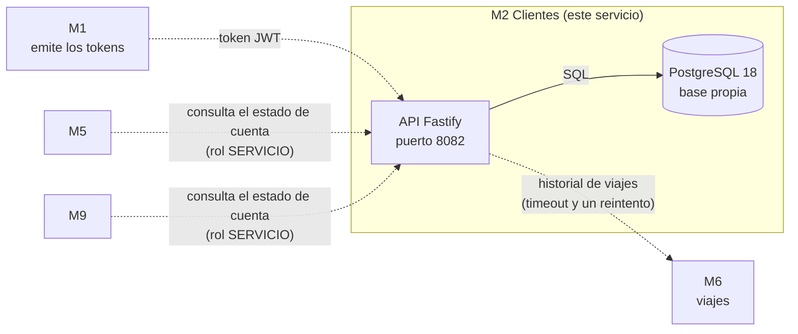

# M2 Clientes · Grupo 17 · TPI Desarrollo de Software 2026

Servicio de clientes de la plataforma de movilidad urbana: perfil, preferencias, direcciones frecuentes, historial resumido de viajes (que obtiene de M6), calificación del conductor y estado de cuenta con bloqueos, que consultan otros módulos. Es uno de los nueve módulos del TPI; los demás los construyen otros grupos.

## Qué hace hoy

Este repositorio tiene la **base del servicio** (spec `specs/003-base-servicio/`): configuración por variables de entorno, base PostgreSQL propia con migraciones, errores `application/problem+json`, autenticación por token, identificador de correlación en los logs, cliente HTTP para llamar a otros módulos con timeout y reintento, imágenes de contenedor y CI.

De las operaciones del contrato (`contrato/openapi.yml`, v1) está implementada solo `GET /health`. Las de negocio llegan con las specs 004 a 008, y mientras tanto la prueba de contrato las informa como pendientes.

## Stack

TypeScript 6 sobre Node.js 24, Fastify 5, PostgreSQL 18 (con `pg` y SQL explícito, sin ORM), migraciones con node-pg-migrate, pruebas con Vitest y Testcontainers, y contrato OpenAPI 3.1 probado con Schemathesis. Versiones exactas y motivos: [`docs/adr/003-stack.md`](docs/adr/003-stack.md) y `package.json`.

## Diagrama

Línea llena: lo que ya funciona. Línea punteada: relación que define el contrato, todavía sin operación implementada.



Mientras no exista M1, los tokens los firma el comando de [Generar un token](#generar-un-token). M2 guarda solo sus datos: los de otros módulos los pide por su API.

## Requisitos

- Node.js 24, desde la 24.2 (con `nvm`: `nvm use 24`). Node 20 está fuera de soporte.
- Docker con compose v2, usable sin `sudo` (la persona tiene que estar en el grupo `docker`). Lo necesitan el servicio y las pruebas de integración.

## Levantar el servicio

Una vez por clon, para que el hook bloquee el push a `main`:

```bash
git config core.hooksPath .githooks
```

Servicio y base, desde un clon limpio y sin crear ningún archivo:

```bash
docker compose up -d --build --wait
```

Termina cuando los dos contenedores están sanos. Comprobar que responde:

```bash
curl -fsS http://localhost:8082/health
```

Responde `{"estado":"ok"}`. Con la base caída responde `503`.

Ver los logs, que son una línea JSON por solicitud con su identificador de correlación:

```bash
docker compose logs m2
```

Parar el servicio y bajar todo:

```bash
docker compose stop m2
docker compose down
```

`docker compose down -v` borra además el volumen `datos-bd`, es decir, **los datos locales de la base**.

## Correr las pruebas

```bash
npm ci
npm test
```

`npm test` corre las pruebas unitarias y las de integración. Las de integración levantan un PostgreSQL real con Testcontainers, así que necesitan Docker. Otros comandos:

```bash
npm run build
npm run lint
```

La prueba de contrato corre Schemathesis (una imagen de Docker) sobre las operaciones implementadas. Necesita el servicio levantado como en la sección anterior:

```bash
npm run contrato:test
```

Opcionalmente, con `--contrato <ruta>` prueba otro archivo: `npm run contrato:test -- --contrato pruebas/ayudas/contrato-salud.yml`. Si el servicio no responde, lo dice y termina con error.

Verificaciones del contrato y de las specs, las mismas que corre CI:

```bash
npx --yes @redocly/cli@2.62.1 lint contrato/openapi.yml
node scripts/spec-check.mjs
```

## Generar un token

Mientras no esté M1, el comando de tokens firma uno con la clave, el emisor y la audiencia que usa el servicio. Se corre dentro del contenedor y escribe solo el token:

```bash
docker compose exec -T m2 node dist/herramientas/token.js --sub 00000000-0000-4000-8000-000000000001 --roles CLIENTE
```

- `--sub`: el identificador de quien llama. Para un CLIENTE es su `clienteId`.
- `--roles`: uno o varios, separados por comas. Los reconocidos: `CLIENTE`, `CONDUCTOR`, `OPERADOR` y `SERVICIO`, en mayúsculas.
- `--vence`: segundos de vida del token (por defecto, 3600).

Para usarlo en una solicitud a una operación protegida:

```bash
TOKEN=$(docker compose exec -T m2 node dist/herramientas/token.js --sub 00000000-0000-4000-8000-000000000001 --roles CLIENTE)
curl -H "Authorization: Bearer $TOKEN" http://localhost:8082/api/v1/<ruta de la operación>
```

Hoy no hay ninguna operación protegida implementada; `/health` no pide token.

## Crear una migración

Las migraciones son archivos SQL en `migraciones/` y el servicio las aplica al arrancar. Para crear una:

```bash
npx node-pg-migrate create <nombre> --migration-file-language sql --migrations-dir migraciones
```

Con `--migrations-dir migraciones` es imprescindible: sin esa opción el archivo queda en `migrations/` y el servicio no lo ve. El archivo trae las secciones `-- Up Migration` y `-- Down Migration`. Un cambio de esquema de la base va siempre en una migración, nunca a mano.

## Variables de entorno

`docker compose` las carga de [`ejemplo.env`](ejemplo.env), que sirve **solo para desarrollo**. Cada línea de ese archivo es de la forma `VARIABLE=${VARIABLE:-valor}`: una variable definida en el entorno de quien corre el comando manda sobre el ejemplo. Por ejemplo, para publicar el servicio en otro puerto:

```bash
M2_PUERTO=9090 docker compose up -d --build --wait
```

| Variable | Obligatoria | Por defecto | Qué es |
|---|---|---|---|
| `M2_URL_BD` | sí | — | URL de la base, `postgres://` o `postgresql://` |
| `M2_PUERTO` | no | `8082` | Puerto de escucha, también el que se publica en la máquina |
| `M2_CLAVE_TOKENS` | sí | — | Clave con la que se firman y validan los tokens, de 32 caracteres o más |
| `M2_EMISOR_TOKENS` | sí | — | Emisor esperado de los tokens (`iss`) |
| `M2_AUDIENCIA_TOKENS` | sí | — | Audiencia esperada de los tokens (`aud`) |
| `M2_CAMPO_ROLES` | no | `roles` | Campo del token que trae los roles |
| `M2_TIEMPO_BD_MS` | no | `2000` | Espera máxima a la base, en milisegundos (de 1 a 2147483647) |
| `M2_TIEMPO_MODULOS_MS` | no | `2000` | Espera máxima por intento a otro módulo, en milisegundos (de 1 a 2147483647) |
| `M2_REINTENTOS_MODULOS` | no | `1` | Reintentos de una lectura a otro módulo, de 0 a 5 |
| `M2_ENCABEZADO_CORRELACION` | no | `X-Request-Id` | Nombre del encabezado de correlación |
| `M2_URL_M6` | sí | — | URL base de M6 (Viajes), `http://` o `https://`, con su ruta `/api/v1`; el servicio no arranca sin ella |
| `M2_AUDIENCIA_M6` | no | `m6-viajes` | Audiencia (`aud`) del token de servicio con el que M2 se presenta ante M6; no puede tener solo espacios |
| `M2_REINTENTAR_DESPUES_S` | no | `5` | Segundos que sugiere `Retry-After` cuando M6 no está disponible, de 1 a 3600 |
| `POSTGRES_USER` | solo para la base | el de `ejemplo.env` | Usuario que crea la imagen de PostgreSQL |
| `POSTGRES_PASSWORD` | solo para la base | el de `ejemplo.env` | Contraseña de ese usuario |
| `POSTGRES_DB` | solo para la base | el de `ejemplo.env` | Base que se crea al inicializar |

Dos cuidados con la base:

- `M2_URL_BD` **repite** el usuario, la contraseña y la base de `POSTGRES_*`: se cambian juntos.
- El volumen `datos-bd` guarda los datos. Con el volumen ya creado, cambiar `POSTGRES_PASSWORD` **no tiene efecto** hasta borrarlo con `docker compose down -v`, que pierde los datos locales.

Las claves y contraseñas de `ejemplo.env` no sirven fuera de una máquina de desarrollo. Un servicio con una variable obligatoria faltante o inválida no arranca: sale con error y el motivo en una línea JSON, que nombra la variable y nunca su valor.

## Cómo está ordenado el repositorio

- `contrato/openapi.yml`: el contrato del módulo, acordado con el Grupo 1. No se edita fuera de una rama `contrato/`.
- `specs/NNN-slug/`: qué se construye (spec), cómo (plan) y en qué pasos (tareas), con la guía de lo implementado.
- `docs/`: principios (`constitution.md`) y decisiones (`adr/`).
- `src/`, `pruebas/`, `migraciones/`, `scripts/`: el código, sus pruebas, las migraciones de la base y la prueba de contrato.
- Las reglas de trabajo del grupo, para personas y agentes, están en [`AGENTS.md`](AGENTS.md) y [`MANUAL.md`](MANUAL.md).
