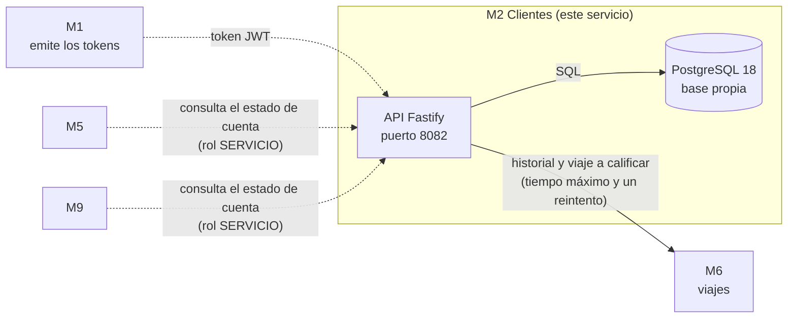

# M2 Clientes · Grupo 17 · TPI Desarrollo de Software 2026

Servicio de clientes de la plataforma de movilidad urbana del TPI. Guarda el perfil de cada cliente, sus preferencias, sus direcciones frecuentes, las calificaciones que les pone a los conductores y su estado de cuenta con bloqueos, que consultan otros módulos. El historial de viajes no lo guarda: se lo pide a M6 (Viajes) en cada consulta. Es uno de los nueve módulos del TPI; los demás los construyen otros grupos.

Están implementadas las 20 operaciones del contrato ([`contrato/openapi.yml`](contrato/openapi.yml), versión 1.0.0).

## Contenido

1. [Empezar en cinco minutos](#1-empezar-en-cinco-minutos)
2. [Qué hace el servicio](#2-qué-hace-el-servicio)
3. [Cómo se relaciona con los otros módulos](#3-cómo-se-relaciona-con-los-otros-módulos)
4. [Probarlo](#4-probarlo)
5. [Pruebas automáticas](#5-pruebas-automáticas)
6. [Variables de entorno](#6-variables-de-entorno)
7. [Para desarrollar](#7-para-desarrollar)

## 1. Empezar en cinco minutos

Hace falta:

- Node.js 24, desde la 24.2 (con `nvm`: `nvm use 24`). Node 20 está fuera de soporte.
- Docker con compose v2, usable sin `sudo` (la persona tiene que estar en el grupo `docker`). Lo necesitan el servicio y las pruebas de integración.

Desde un clon limpio, sin crear ningún archivo:

```bash
docker compose up -d --build --wait      # levanta M2 y su base PostgreSQL; termina cuando los dos están sanos
curl -fsS http://localhost:8082/health   # responde {"estado":"ok"}
node scripts/demo.mjs                    # recorre las 20 operaciones y comprueba cada respuesta
docker compose down                      # al terminar
```

La demostración imprime una línea por paso, con ✔ o ✘, y termina con «Todo en orden: 51 pasos comprobados.». Levanta por su cuenta un M6 simulado para el historial y las calificaciones, y lo borra al terminar.

Si algo no anda:

| Qué pasa | Qué hacer |
|---|---|
| `permission denied` al usar Docker | Agregar el usuario al grupo `docker`, cerrar la sesión y volver a entrar |
| El puerto 8082 está ocupado | `M2_PUERTO=8090 docker compose up -d --build --wait` y `M2_PUERTO=8090 node scripts/demo.mjs` |
| La demostración dice que el servicio no responde | Levantarlo con `docker compose up -d --build --wait` |
| `/health` responde `503` | La base no está disponible: `docker compose ps` y `docker compose logs bd` |

Más casos, el recorrido completo y cómo probar a mano: [`docs/probar-m2.md`](docs/probar-m2.md).

## 2. Qué hace el servicio

Todas las rutas cuelgan de `/api/v1`, salvo `GET /health`, que no pide token. Las demás piden un token y admiten ciertos roles. Un `CLIENTE` solo opera sobre su propio perfil: el `sub` de su token tiene que ser el `clienteId` de la ruta. Un `OPERADOR` lee el de cualquiera.

| Operación | Método y ruta | Qué hace | Roles | Spec |
|---|---|---|---|---|
| `verificarSalud` | `GET /health` | Dice si el servicio y su base responden | sin token | 003 |
| `crearCliente` | `POST /clientes` | Crea el perfil del cliente autenticado | CLIENTE | 004 |
| `obtenerCliente` | `GET /clientes/{clienteId}` | Consulta el perfil | CLIENTE, OPERADOR | 004 |
| `actualizarCliente` | `PATCH /clientes/{clienteId}` | Actualiza el perfil | CLIENTE | 004 |
| `obtenerEstadoCuenta` | `GET /clientes/{clienteId}/estado-cuenta` | Estado del perfil y bloqueos vigentes; lo consultan otros módulos | CLIENTE, OPERADOR, SERVICIO | 004 |
| `listarBloqueos` | `GET /clientes/{clienteId}/bloqueos` | Historial de bloqueos, vigentes y levantados | OPERADOR | 004 |
| `crearBloqueo` | `POST /clientes/{clienteId}/bloqueos` | Bloquea administrativamente al cliente | OPERADOR | 004 |
| `obtenerBloqueo` | `GET /clientes/{clienteId}/bloqueos/{bloqueoId}` | Consulta un bloqueo | OPERADOR | 004 |
| `levantarBloqueo` | `PATCH /clientes/{clienteId}/bloqueos/{bloqueoId}` | Levanta un bloqueo | OPERADOR | 004 |
| `listarDirecciones` | `GET /clientes/{clienteId}/direcciones` | Lista las direcciones frecuentes | CLIENTE, OPERADOR | 005 |
| `crearDireccion` | `POST /clientes/{clienteId}/direcciones` | Registra una dirección frecuente | CLIENTE | 005 |
| `obtenerDireccion` | `GET /clientes/{clienteId}/direcciones/{direccionId}` | Consulta una dirección | CLIENTE, OPERADOR | 005 |
| `actualizarDireccion` | `PATCH /clientes/{clienteId}/direcciones/{direccionId}` | Actualiza una dirección | CLIENTE | 005 |
| `eliminarDireccion` | `DELETE /clientes/{clienteId}/direcciones/{direccionId}` | Elimina una dirección | CLIENTE | 005 |
| `obtenerPreferencias` | `GET /clientes/{clienteId}/preferencias` | Consulta las preferencias | CLIENTE, OPERADOR | 006 |
| `guardarPreferencias` | `PUT /clientes/{clienteId}/preferencias` | Guarda las preferencias | CLIENTE | 006 |
| `listarHistorialViajes` | `GET /clientes/{clienteId}/viajes` | Historial resumido de viajes, que arma con lo que responde M6 | CLIENTE, OPERADOR | 007 |
| `listarCalificaciones` | `GET /clientes/{clienteId}/calificaciones` | Lista las calificaciones que hizo el cliente | CLIENTE, OPERADOR | 008 |
| `calificarConductor` | `POST /clientes/{clienteId}/calificaciones` | Califica al conductor de un viaje completado | CLIENTE | 008 |
| `obtenerCalificacion` | `GET /clientes/{clienteId}/calificaciones/{calificacionId}` | Consulta una calificación | CLIENTE, OPERADOR | 008 |

El contrato es la fuente de verdad de rutas, esquemas, roles y errores; esta tabla lo resume. Cada spec está en `specs/NNN-…/` y tiene una `guia.md` que explica lo hecho, tarea por tarea.

Detrás de las operaciones está la base del servicio (spec 003): configuración por variables de entorno, base PostgreSQL propia con migraciones, errores en `application/problem+json`, autenticación por token, identificador de correlación en los logs, cliente HTTP para llamar a otros módulos con tiempo máximo y reintento, imágenes de contenedor y CI.

## 3. Cómo se relaciona con los otros módulos

Línea llena: M2 llama a otro módulo o a su base. Línea punteada: otro módulo llama a M2 o emite el token con el que lo hace.



- **M2 guarda solo sus datos.** Los de otros módulos los pide por su API.
- **Los tokens.** Mientras no exista M1, los firma el comando de [Generar un token](#generar-un-token). M2 también valida tokens RS256 de Keycloak con `M2_MODO_TOKENS=jwks` (spec 080).
- **M5 y M9** consultan el estado de cuenta de un cliente con el rol `SERVICIO`.

### Qué le pide M2 a M6

Dos operaciones dependen de M6, y solo esas dos:

- El historial (`listarHistorialViajes`) le pide la lista de viajes del cliente: `GET /trips?clientId=…`.
- Calificar (`calificarConductor`) le pide el viaje: `GET /trips/{tripId}`, para saber si es de ese cliente, si está completado y quién fue el conductor.

En cada pedido M2 se presenta con un token de servicio de vida corta (rol `SERVICIO`, spec 007) y manda el identificador de correlación de la solicitud en dos encabezados: el configurado (`X-Request-Id`) y `X-Correlation-Id`, que es el que lee M6 según su contrato. Así un pedido se puede seguir en los logs de los dos módulos: `docker compose logs m2 | grep 'llamada a M6'`.

### Qué responde M2 cuando M6 falla

| Lo que pasa con M6 | Qué responde M2 |
|---|---|
| No contesta a tiempo, corta la conexión, responde `5xx` o algo que no es JSON | Reintenta a los 200 ms (una vez, salvo que se cambie `M2_REINTENTOS_MODULOS`). Si vuelve a fallar: `503` con `Retry-After` |
| Responde `200` con una forma que no es la de su contrato | `503` con `Retry-After`, sin reintentar |
| Limita los pedidos (`429`) | En el historial: `503`, sin reintentar, con el `Retry-After` que informa M6 si va de 1 a 3600 segundos y, si no, con el configurado. Al calificar todavía responde `500`; lo cambia la spec 008 (issue #96) |
| Responde `404` al pedirle un viaje | Al calificar: `404`, el viaje no existe |
| Rechaza el pedido con otro `4xx` | `500`, sin reintentar: es un problema de configuración entre módulos, no del cliente |

El `Retry-After` configurado es `M2_REINTENTAR_DESPUES_S`. M2 nunca devuelve un historial parcial ni copia en su respuesta o en sus logs el cuerpo de un error de M6. Las operaciones que no dependen de M6 siguen respondiendo aunque M6 esté caído.

El contrato de M6 que usa M2 está en [`contrato/dependencias/m6.yml`](contrato/dependencias/m6.yml).

## 4. Probarlo

Hay tres maneras, de la más rápida a la más detallada.

### La demostración

```bash
docker compose up -d --build --wait
node scripts/demo.mjs              # una línea por paso
node scripts/demo.mjs --detalle    # además, el curl equivalente y la respuesta completa de cada paso
```

Crea un cliente nuevo en cada corrida, así que se puede repetir sin limpiar la base. Qué recorre, requisito por requisito: [`docs/probar-m2.md`](docs/probar-m2.md), sección 1.

### El panel (interfaz web)

«El panel» (spec 071) es una interfaz web para usar las 20 operaciones sin armar `curl` a mano. Vive en `panel/` y se levanta de dos formas:

```bash
# 1. Todo en contenedores: M2, la base, el M6 simulado y el panel.
docker compose --profile panel up -d --build --wait
# 2. El panel como proceso en la máquina, contra M2 y el M6 simulado de compose:
docker compose up -d --build --wait
docker compose --profile panel up -d --build --wait m6 bd-puente
npm ci && npm run panel
```

Después se abre <http://localhost:8083> (`node scripts/panel-humo.mjs` comprueba que está sano).

- El panel escucha solo en `127.0.0.1`, porque firma tokens de desarrollo.
- La sesión, los clientes y el M6 son simulados, y lo dice el encabezado de cada vista.
- La vista «Demostración» (spec 072, `#/demostracion`) recorre los 37 casos de la API con sus resultados y lanza las pruebas de integridad: altas y calificaciones simultáneas, y la restricción del puntaje en la base. También permite apagar y encender la base para ver a M2 responder `503` y recuperarse.
- Contar filas y probar la restricción funcionan con cualquiera de las dos formas de levantar el panel: la base llega por el servicio `bd-puente`, que publica `127.0.0.1:5433` solo con el perfil `panel`.
- Apagar y encender la base solo funcionan con la segunda forma (panel en la máquina y tu usuario en el grupo `docker`). En el contenedor esos dos botones quedan deshabilitados, con su explicación.

Qué hace cada vista, qué está simulado, qué comprueba cada prueba de integridad y cómo activar Docker: [`docs/probar-m2.md`](docs/probar-m2.md), sección 7.

### A mano, con `curl`

#### Generar un token

Mientras no esté M1, el comando de tokens firma uno con la clave, el emisor y la audiencia que usa el servicio. Se corre dentro del contenedor y escribe solo el token:

```bash
docker compose exec -T m2 node dist/herramientas/token.js --sub 00000000-0000-4000-8000-000000000001 --roles CLIENTE
```

- `--sub`: el identificador de quien llama. Para un CLIENTE es su `clienteId`.
- `--roles`: uno o varios, separados por comas. Los reconocidos: `CLIENTE`, `CONDUCTOR`, `OPERADOR` y `SERVICIO`, en mayúsculas.
- `--vence`: segundos de vida del token (por defecto, 3600).

Para usarlo en una solicitud a una operación protegida:

```bash
TOKEN=$(docker compose exec -T m2 node dist/herramientas/token.js --sub 00000000-0000-4000-8000-000000000001 --roles CLIENTE)
curl -H "Authorization: Bearer $TOKEN" http://localhost:8082/api/v1/<ruta de la operación>
```

Qué roles admite cada operación está en la tabla de la sección 2 y en su `security` en el contrato.

#### Probar las calificaciones y el historial con un M6 simulado

El compose sin perfiles no trae un M6. Para probar a mano las dos operaciones que dependen de él alcanza con un contenedor que haga de M6: el servicio apunta por defecto a `http://m6:3006`, así que basta darle a un contenedor de la red del compose el nombre de red `m6`. Con el servicio levantado (`docker compose up -d --build --wait`):

```bash
CLIENTE=$(cat /proc/sys/kernel/random/uuid)   # el cliente de la prueba
VIAJE=11111111-1111-4111-8111-111111111111
BASE=http://localhost:8082/api/v1
token() { docker compose exec -T m2 node dist/herramientas/token.js --sub "$1" --roles "$2"; }

# Un M6 que dice que todo viaje está COMPLETED, es de $CLIENTE y lo manejó un conductor fijo. Se detiene con:
#   docker rm -f m6-simulado
docker run --rm -d --name m6-simulado --network "$(docker compose ps -q m2 | xargs docker inspect -f '{{range $k, $v := .NetworkSettings.Networks}}{{$k}}{{end}}')" \
  --network-alias m6 -e CLIENTE="$CLIENTE" m2-clientes:0.1.0 node -e "
const viaje = (id) => ({ id, state: 'COMPLETED', vehicleType: 'CAR', clientId: process.env.CLIENTE, driverId: '0b1c2d3e-4f5a-4b6c-8d7e-9f0a1b2c3d4e', createdAt: '2026-10-01T10:00:00Z' });
require('http').createServer((req, res) => {
  const ruta = req.url.split('?')[0];
  res.setHeader('content-type', 'application/json');
  res.end(JSON.stringify(ruta.endsWith('/trips')
    ? { items: [viaje('$VIAJE')], page: 1, pageSize: 20, total: 1 }
    : viaje(ruta.split('/').pop())));
}).listen(3006);"

TOKEN=$(token "$CLIENTE" CLIENTE)
# 1. El perfil: el cliente tiene que existir en M2 (201).
curl -s -X POST $BASE/clientes -H "Authorization: Bearer $TOKEN" -H "Idempotency-Key: perfil-1" \
  -H 'Content-Type: application/json' -d '{"nombre":"Ana","apellido":"Gómez","telefono":"+5493624000000"}'
# 2. Calificar el viaje: 201 con la calificación y su Location. El conductor sale de M6.
curl -si -X POST $BASE/clientes/$CLIENTE/calificaciones -H "Authorization: Bearer $TOKEN" -H "Idempotency-Key: calificacion-1" \
  -H 'Content-Type: application/json' -d "{\"viajeId\":\"$VIAJE\",\"puntaje\":5,\"comentario\":\"Muy amable\"}"
# 3. Repetir lo mismo (misma clave y cuerpo): el mismo 201, sin volver a preguntarle a M6.
# 4. Calificar el mismo viaje con otra clave: 409 con type /errores/calificacion-duplicada.
curl -s -X POST $BASE/clientes/$CLIENTE/calificaciones -H "Authorization: Bearer $TOKEN" -H "Idempotency-Key: calificacion-2" \
  -H 'Content-Type: application/json' -d "{\"viajeId\":\"$VIAJE\",\"puntaje\":1}"
# 5. Listarlas (un OPERADOR también puede, de cualquier cliente) y ver el historial, donde el viaje ya sale con "calificado": true.
curl -s "$BASE/clientes/$CLIENTE/calificaciones?page=0&size=10" -H "Authorization: Bearer $TOKEN"
curl -s $BASE/clientes/$CLIENTE/viajes -H "Authorization: Bearer $TOKEN"
```

Los casos que dependen de M6 se ven cambiando lo que responde: con un viaje `IN_PROGRESS` da `422` (`/errores/viaje-no-completado`), con uno de otro cliente o inexistente da `404`, y con el contenedor detenido (`docker rm -f m6-simulado`) da `503` con `Retry-After`. Los casos a mano de cada spec están en su `guia.md`.

#### Ver los logs y bajar todo

```bash
docker compose logs m2     # una línea JSON por solicitud, con su identificador de correlación
docker compose stop m2     # parar solo el servicio
docker compose down        # bajar todo; los datos quedan en el volumen
```

`docker compose down -v` borra además el volumen `datos-bd`, es decir, **los datos locales de la base**.

## 5. Pruebas automáticas

```bash
npm ci
npm test
```

| Comando | Qué prueba | Qué necesita |
|---|---|---|
| `npm test` | Las pruebas unitarias y las de integración, que levantan un PostgreSQL real con Testcontainers | Docker |
| `npm run lint` y `npm run build` | El estilo del código y que compila | — |
| `npm run contrato:test` | El servicio contra su contrato, con Schemathesis (una imagen de Docker), en las 20 operaciones | El servicio levantado (`docker compose up -d --build --wait`) |
| `npm run integracion:m6` | M2 con el M6 real del Grupo 12: historial, calificación y qué pasa cuando M6 se cae (spec 081) | Docker, e internet la primera vez |
| `npm run keycloak:test` | M2 en modo `jwks` junto a Keycloak, con tokens RS256 pedidos al realm: cada rol ve lo suyo y M2 sigue de pie si Keycloak se cae (spec 080) | Docker |
| `npm run panel:navegador` | El panel en Chrome | Chrome y Docker |
| `npx --yes @redocly/cli@2.62.1 lint contrato/openapi.yml` | Que el contrato es un OpenAPI válido | — |
| `node scripts/spec-check.mjs` | El formato de las specs, lo mismo que corre CI | — |

Notas:

- **Prueba de contrato.** No hay un M6, así que `listarHistorialViajes` y `calificarConductor` responden el `503` que el contrato declara, y `schemathesis.toml` lo acepta solo en esas dos. Con `--contrato <ruta>` prueba otro archivo: `npm run contrato:test -- --contrato pruebas/ayudas/contrato-salud.yml`. Si el servicio no responde, lo dice y termina con error.
- **Con el M6 real.** Cómo levantar M2 con el M6 real, qué commit de M6 usa y qué salida esperar: [`docs/probar-m2.md`](docs/probar-m2.md), sección 8.
- **Con Keycloak.** Cómo levantarlo, pedir un token de persona y uno de servicio, y probar una operación a mano: [`docs/probar-m2.md`](docs/probar-m2.md), sección 9.
- `integracion:m6`, `keycloak:test` y `panel:navegador` son aparte de `npm test`: hay que correrlas a propósito.

## 6. Variables de entorno

`docker compose` las carga de [`ejemplo.env`](ejemplo.env), que sirve **solo para desarrollo**. Cada línea de ese archivo es de la forma `VARIABLE=${VARIABLE:-valor}`: una variable definida en el entorno de quien corre el comando manda sobre el ejemplo. Por ejemplo, para publicar el servicio en otro puerto:

```bash
M2_PUERTO=9090 docker compose up -d --build --wait
```

Un servicio con una variable obligatoria faltante o inválida no arranca: sale con error y el motivo en una línea JSON, que nombra la variable y nunca su valor.

**El servicio y su base**

| Variable | Obligatoria | Por defecto | Qué es |
|---|---|---|---|
| `M2_URL_BD` | sí | — | URL de la base, `postgres://` o `postgresql://` |
| `M2_PUERTO` | no | `8082` | Puerto de escucha, también el que se publica en la máquina |
| `M2_TIEMPO_BD_MS` | no | `2000` | Espera máxima a la base, en milisegundos (de 1 a 2147483647) |
| `M2_ENCABEZADO_CORRELACION` | no | `X-Request-Id` | Nombre del encabezado de correlación que M2 recibe y devuelve. A M6 le manda el mismo identificador en ese encabezado y además en `X-Correlation-Id`, el de su contrato, salvo que el identificador pase de 100 caracteres |
| `POSTGRES_USER` | solo para la base | el de `ejemplo.env` | Usuario que crea la imagen de PostgreSQL |
| `POSTGRES_PASSWORD` | solo para la base | el de `ejemplo.env` | Contraseña de ese usuario |
| `POSTGRES_DB` | solo para la base | el de `ejemplo.env` | Base que se crea al inicializar |

**Los tokens**

| Variable | Obligatoria | Por defecto | Qué es |
|---|---|---|---|
| `M2_MODO_TOKENS` | no | `hs256` | Cómo se validan los tokens: `hs256` (clave compartida, para desarrollo) o `jwks` (RS256 con las claves públicas de Keycloak, spec 080; ver [`docs/probar-m2.md`](docs/probar-m2.md), sección 9) |
| `M2_CLAVE_TOKENS` | sí | — | Clave con la que se firman y validan los tokens, de 32 caracteres o más |
| `M2_EMISOR_TOKENS` | sí | — | Emisor esperado de los tokens (`iss`) |
| `M2_AUDIENCIA_TOKENS` | sí | — | Audiencia esperada de los tokens (`aud`) |
| `M2_CAMPO_ROLES` | no | `roles` | Campo del token que trae los roles |
| `M2_URL_JWKS` | solo con `jwks` | — | URL de las claves públicas (JWKS) de Keycloak, `http://` o `https://` y sin usuario ni contraseña; en `hs256` no se usa, pero si está se valida |

**Las llamadas a M6**

| Variable | Obligatoria | Por defecto | Qué es |
|---|---|---|---|
| `M2_URL_M6` | sí | — | URL base de M6 (Viajes), `http://` o `https://`, sin usuario ni contraseña. M6 sirve en `/trips`, así que no lleva `/api/v1`; el servicio no arranca sin ella |
| `M2_AUDIENCIA_M6` | no | `m6-viajes` | Audiencia (`aud`) del token de servicio con el que M2 se presenta ante M6; no puede estar en blanco ni tener espacios al principio o al final |
| `M2_TIEMPO_MODULOS_MS` | no | `2000` | Espera máxima por intento a otro módulo, en milisegundos (de 1 a 2147483647) |
| `M2_REINTENTOS_MODULOS` | no | `1` | Reintentos de una lectura a otro módulo, de 0 a 5 |
| `M2_REINTENTAR_DESPUES_S` | no | `5` | Segundos del `Retry-After` del `503` cuando M6 no está disponible, de 1 a 3600. Si M6 limita los pedidos (`429`) e informa su propio `Retry-After` de 1 a 3600 segundos, el historial responde con el de M6 y no con este |

Las variables del panel y de los M6 de prueba (`PANEL_*`, `M6_*`) están en `ejemplo.env`, cada una con su explicación.

Dos cuidados con la base:

- `M2_URL_BD` **repite** el usuario, la contraseña y la base de `POSTGRES_*`: se cambian juntos.
- El volumen `datos-bd` guarda los datos. Con el volumen ya creado, cambiar `POSTGRES_PASSWORD` **no tiene efecto** hasta borrarlo con `docker compose down -v`, que pierde los datos locales.

Las claves y contraseñas de `ejemplo.env` no sirven fuera de una máquina de desarrollo.

## 7. Para desarrollar

### Una vez por clon

```bash
git config core.hooksPath .githooks
```

El hook bloquea el push a `main` y valida el nombre de la rama.

### Stack

TypeScript 6 sobre Node.js 24, Fastify 5, PostgreSQL 18 (con `pg` y SQL explícito, sin ORM), migraciones con node-pg-migrate, pruebas con Vitest y Testcontainers, y contrato OpenAPI 3.1 probado con Schemathesis. Versiones exactas y motivos: [`docs/adr/003-stack.md`](docs/adr/003-stack.md) y `package.json`.

### Crear una migración

Las migraciones son archivos SQL en `migraciones/` y el servicio las aplica al arrancar. Para crear una:

```bash
npx node-pg-migrate create <nombre> --migration-file-language sql --migrations-dir migraciones
```

`--migrations-dir migraciones` es imprescindible: sin esa opción el archivo queda en `migrations/` y el servicio no lo ve. El archivo trae las secciones `-- Up Migration` y `-- Down Migration`. Un cambio de esquema de la base va siempre en una migración, nunca a mano.

### Cómo está ordenado el repositorio

| Dónde | Qué hay |
|---|---|
| `contrato/openapi.yml` | El contrato del módulo, acordado con el Grupo 1. No se edita fuera de una rama `contrato/` |
| `contrato/dependencias/` | Los contratos de los módulos que M2 consume, como el de M6 |
| `specs/NNN-slug/` | Qué se construye (spec), cómo (plan) y en qué pasos (tareas), con la guía de lo implementado |
| `docs/` | Principios (`constitution.md`), decisiones (`adr/`), la guía de pruebas (`probar-m2.md`) y las guías de los cambios chicos (`guias/`) |
| `src/` | El código del servicio |
| `pruebas/` | Sus pruebas |
| `migraciones/` | Las migraciones de la base |
| `panel/` | La interfaz web y el M6 simulado |
| `scripts/` | La prueba de contrato, la demostración (`scripts/demo.mjs`) y las verificaciones de CI |

Las reglas de trabajo del grupo, para personas y agentes, están en [`AGENTS.md`](AGENTS.md) y [`MANUAL.md`](MANUAL.md).
